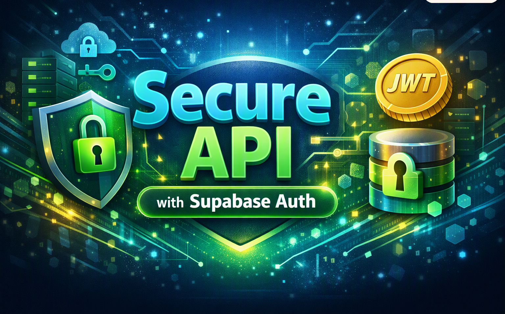
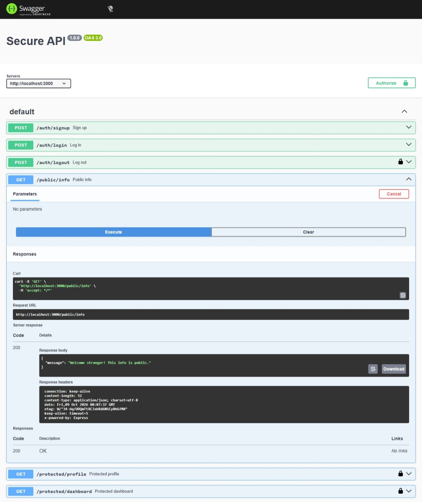
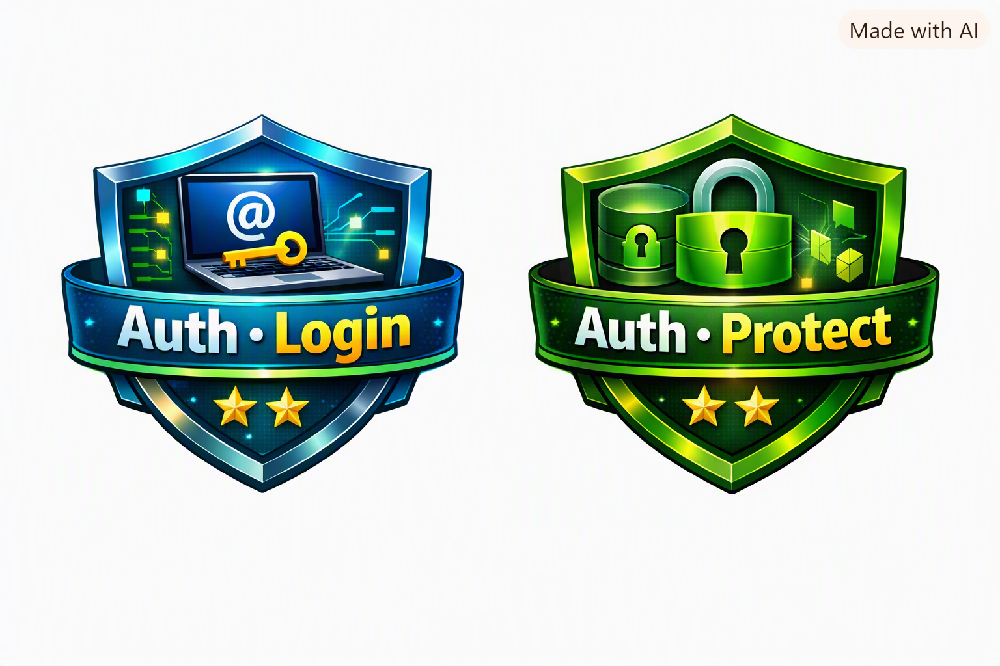
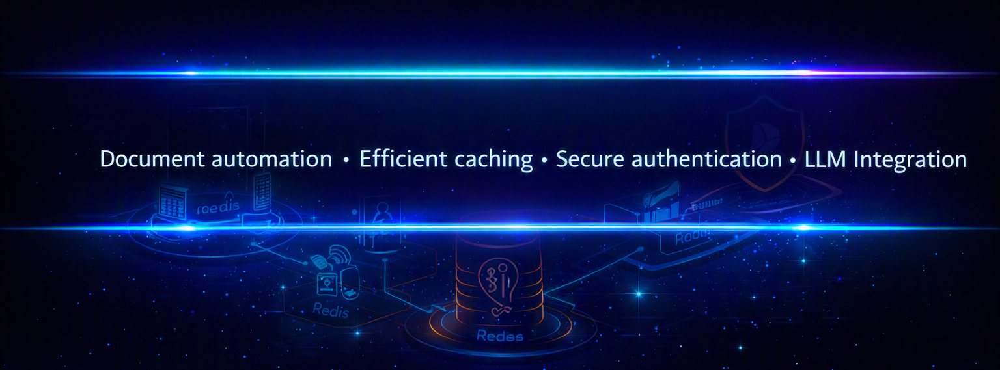

# Secure API with Supabase Auth

## 🛡️ Assignment Details


## 📌 Overview
This project demonstrates how to build a secure API using Node.js, Express, and Supabase Auth.
It implements modern authentication flows with JWTs, middleware protection, and Swagger UI documentation.

## ⚙️ Setup Instructions
1. Clone the Repository
```bash
git clone https://github.com/<your-username>/secure-api.git
cd secure-api

```
2. Install Dependencies
```bash
npm install
```
3. Environment Variables
Create a .env file in the project root:

```bash
SUPABASE_URL=your_project_url
SUPABASE_KEY=your_anon_key
PORT=3000

```

⚠️ **Important**: .env is already listed in .gitignore. Never commit Supabase keys.

4. Run the Server
```bash
npm start

```

Server will start at:
http://localhost:3000


---


## 🔑 Secure Auth Cycle

**1. Signup →** Create user with email + password
`POST /auth/signup`

**2. Login →** Returns `access_token` + `refresh_token`  
`POST /auth/login`

**3. Protected routes →** Require
`Authorization: Bearer <access_token>`

- If expired, middleware refreshes using `X-Refresh-Token`

- New tokens are attached in response headers (`x-access-token, x-refresh-token`)

**4. Logout →** Revoke refresh token
`POST /auth/logout`

**5. Refresh →** Rotate tokens and extend session
`POST /auth/refresh`

---

## 🔑 API Reference
| Endpoint | Method | Auth Required | Description | Status Codes |
| --- | --- | --- | --- | --- |
| ``/auth/signup`` | POST | No | Register a new user | 201, 400 |
| ``/auth/login`` | POST | No | Log in and receive JWT + refresh | 200, 400, 401 |
| ``/auth/logout`` | POST | Yes (Bearer) | Log out user session | 204, 401 |
| ``/public/info`` | GET | No | Public data | 200 |
| ``/protected/profile`` | GET | Yes (Bearer) | View private profile data | 200, 401 |
| ``/protected/dashboard`` | GET | Yes (Bearer) | Example protected route | 200, 401 |


---

## 🔑 Full Curl Workflow
### Sign Up
```bash
curl -i -X POST http://localhost:3000/auth/signup \
  -H "Content-Type: application/json" \
  -d '{"email":"your_email@example.com","password":"your_password"}'


```

### Log In
```bash
curl -i -X POST http://localhost:3000/auth/login \
  -H "Content-Type: application/json" \
  -d '{"email":"your_email@example.com","password":"your_password"}'


  ```

Response includes `access_token` and `refresh_token`.

### Public Info
```bash
curl -i http://localhost:3000/public/info

```

### Protected Profile


```bash
curl -i http://localhost:3000/protected/profile \
  -H "Authorization: Bearer <ACCESS_TOKEN>"

  ```

### Protected Dashboard
```bash
curl -i http://localhost:3000/protected/dashboard \
  -H "Authorization: Bearer <ACCESS_TOKEN>"

```
### Logout
```bash
curl -i -X POST http://localhost:3000/auth/logout \
  -H "Authorization: Bearer <ACCESS_TOKEN>"

```

### Refresh Token Rotation
```bash
curl -i -X POST http://localhost:3000/auth/refresh \
  -H "X-Refresh-Token: <REFRESH_TOKEN>"

```
⚠️ **Important**: Refresh tokens only work **before logout**. Once you log out, the refresh token is invalidated and you must log in again to get a new pair.

---

✅ Flow Summary
- Signup → Create user

- **Login →** Get tokens

- **Protected →** Access with JWT

- **Logout →** End session

- **Refresh →** Rotate tokens (valid until logout)

---

## ▶️ Running the Client Demo
1. Start the server:

```bash
npm start

```

2. Log in with curl to get fresh tokens:

```bash
curl -i -X POST http://localhost:3000/auth/login -H "Content-Type: application/json" -d "{\"email\":\"<your_email>\",\"password\":\"<your_password>\"}"

```

3. Paste the new `access_token` and `refresh_token` into `client/client`.js.

4. Run the client script:

```bash
node client/client.js
(Optional) Enable looping with `setInterval` inside `client.js` to watch auto‑refresh when the access token expires.

```
---

## 📖 Swagger UI
Swagger UI is available at:
`http://localhost:3000/docs`

Protected routes show a 🔒 lock icon.

Click **Authorize**, paste JWT, and test endpoints directly.

📸 Example Swagger UI screenshot:



---

## 🛡️ Security Notes
Authentication handled by **Supabase Auth** (Identity Provider).

JWTs are verified via middleware before accessing protected routes.

Proper status codes used:

- `201` → Signup success

- ` 200` → Login success / Protected route success

- ` 204` → Logout success

- ` 400` → Bad request (missing inputs)

- ` 401` → Unauthorized (missing/invalid token)


---

## 🚀 Publishing
Repo is public on GitHub.

A peer can clone, add their own `.env` values, and run the API in under 5 minutes.


---


## 🤖 Bonus: AI vs Me (Optional)

This section compares how an AI assistant generated a similar secure‑API setup versus my manual implementation.



**Focus Points:**
- Did the AI handle `Bearer <token>` parsing correctly?
- Were any security flaws introduced in its generated code?
- What assumptions did it make compared to your handcrafted logic?


---

### 🌟 Portfolio Highlight

  
✅ **Backend AI Engineer** — I design and ship production AI systems — from optimized models and ML pipelines to full-stack React/Node apps running on automated, containerized infrastructure. I turn research into reliable, measurable software.

---



© 2026 Leonard Phokane | All rights reserved.
